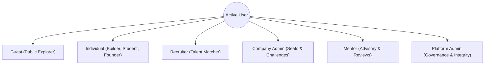

# SkillForge Manual 00: Getting Started & The Six Contexts

## 1. Overview & Architecture
SkillForge is a role-aware collaborative engineering and talent verification platform. Rather than forcing users into separate siloed applications, SkillForge organizes your workspace into **Six Distinct Contexts**:

### The Six North Star Contexts
1. **Guest**: Explore public projects, public portfolios, and sign in.
2. **Individual**: Home, Discover, My Projects, Challenges & Hackathons, Portfolio, Inbox.
3. **Recruiter**: Home, Jobs, Talent, Pipeline, Challenges, Messages.
4. **Company Admin**: All Recruiter items + Company (Profile, Seats, Verification) + Analytics.
5. **Mentor**: Home, Requests, Mentored Projects, Feedback, Availability.
6. **Platform Admin**: Overview, Moderation, Verification, Certificates, Skills, Users, Audit, AI Evaluation.

---

## 2. Click-by-Click Instructions

### Switching Contexts in 1 Click
1. Look at the top navigation bar and locate the **Context Switcher** pill (e.g. `Context: Individual`).
2. Click the pill to expand the dropdown of available personas.
3. Select your desired persona (e.g., `"Recruiter"` or `"Mentor"`).
4. The sidebar navigation, home cockpit, and capabilities instantly adapt without reloading the page.

### Navigation Rules
- Every context displays strictly $\le 6$ primary workspaces in the left navigation sidebar.
- Tools and AI intelligence utilities are grouped cleanly under "Tools & Capabilities".
- Secondary utilities (Settings, Help, Search, Notification Bell) reside in the top bar.

---

## 3. Edge Cases & Error Handling
- **Visiting an Unauthorized Route**: If you visit a route belonging to another role (e.g., navigating to `/pipeline` while in Individual context), SkillForge displays a friendly **Access Denied** guard screen with a 1-click button to switch to the required context.
- **Session Persistence**: Your selected active context is saved to `localStorage` and persists across browser refreshes.

---

## 4. Related Flows & Next Steps
- [Manual 01: Onboarding, Profile & Resume Intelligence](./01_onboarding_and_profile.md)
- [Manual 02: Project Creation & AI Requirements Scaffolding](./02_create_project_and_ai_scaffolding.md)
