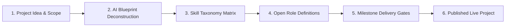

# SkillForge Manual 02: Project Creation & AI Requirements Scaffolding

## 1. Overview
This manual details the step-by-step process of creating a new collaborative engineering project, decomposing ideas using **Project Blueprint AI**, and structuring delivery milestones.

### Prerequisites
- Active SkillForge session in the **Individual** context.
- High-level concept, problem statement, or target tech stack.

---

## 2. Click-by-Click Instructions

### Step 1: Initiating Project Creation
1. From the top bar or My Projects header, click **"+ Create Project"**.
2. Enter your project title (e.g., `Distributed Consensus & Event Hub`).
3. Select a category (e.g., `Systems & Backend`, `Fullstack Engineering`, `Machine Learning`).

### Step 2: Generating AI Requirements
1. In the **"Problem Statement & Objectives"** textarea, describe your core technical challenges.
2. Click **"Deconstruct into Skill Tree"**.
3. The AI engine automatically generates:
   - Technical architecture overview.
   - Recommended team size (min/max).
   - Core taxonomy skills required (e.g. `Kafka`, `Go`, `Docker`).
   - Milestone schedule with verification gates.

### Step 3: Publishing & Launching
1. Review the open role positions (e.g. `Backend Architect`, `DevOps Lead`).
2. Set visibility to **"Public"** or **"Invite Only"**.
3. Click **"Publish Project & Open Collaboration"**.

---

## 3. Edge Cases & Error Handling
- **Validation Errors**: If the team size is less than 1 or exceeds 10, the form will highlight the field in red before submission.
- **Private Projects**: Private projects can still utilize AI collaborator matching; candidates receive anonymous invitation summaries until accepted.

---

## 4. Related Flows & Next Steps
- [Manual 03: Find & Invite Collaborators](./03_find_and_invite_collaborators.md)
- [Manual 04: Project Room Execution & Milestone Proof](./04_project_room_execution.md)
