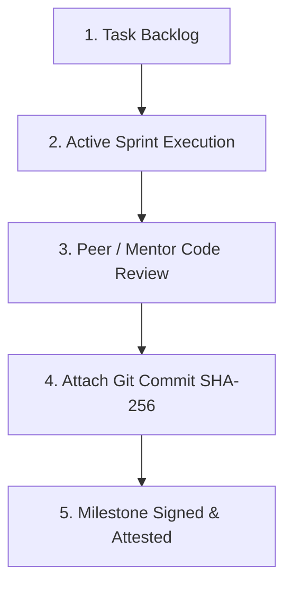

# SkillForge Manual 04: Project Room Execution & Milestone Proof

## 1. Overview
The Project Room is the central collaboration cockpit where teams execute sprints, assign Kanban tasks, share architectural documents, and record cryptographically signed Git commits.

### Prerequisites
- Active project team membership.
- Git repository linked or commit hashes ready for attestation.

---

## 2. Click-by-Click Instructions

### Step 1: Accessing the Project Room
1. In the sidebar, click **"My Projects"**.
2. Locate your active project card and click **"Open Workspace"** or **"Room"**.
3. You enter the multi-tab Project Room with Tasks, Chat, Milestones, and Telemetry.

### Step 2: Managing Tasks & Sprint Velocity
1. Click **"+ Add Task"** to create a technical deliverable.
2. Assign the task to a team member and set a milestone target.
3. Move tasks across the Kanban board columns (*Backlog*, *In Progress*, *Code Review*, *Done*).

### Step 3: Attaching Commit Proof
1. When moving a task to *Done*, click **"Attach Commit Proof"**.
2. Paste the Git commit hash (SHA-256) from your repository.
3. The system verifies commit ownership against your authenticated GitHub identity.

---

## 3. Edge Cases & Error Handling
- **Overdue Milestone Alert**: If milestone completion falls behind schedule by 7+ days, the status beacon turns yellow, notifying team members on their Home cockpit.
- **Unverified Commits**: Commits authored under emails not verified on your SkillForge account cannot be used for cryptographic skill attestation.

---

## 4. Related Flows & Next Steps
- [Manual 05: Completion, Verification & Certificates](./05_completion_verification_and_certificates.md)
- [Manual 06: Project Rescue & Velocity Recovery](./06_project_rescue.md)
