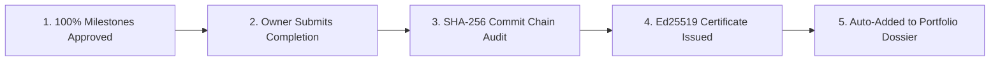

# SkillForge Manual 05: Completion, Verification & Certificates

## 1. Overview
When all project milestones are completed, the project owner seals the project. SkillForge audits the commit ledger and issues an immutable, verifiable completion certificate.

### Prerequisites
- All milestones in the project marked as approved.
- All team member contributions recorded.

---

## 2. Click-by-Click Instructions

### Step 1: Submitting Project Completion
1. In the Project Room, open the **"Certification"** tab.
2. Review the summary of approved milestones, total commits, and member contribution shares.
3. Click **"Complete Project & Issue Credentials"**.

### Step 2: Cryptographic Signature & Issuance
1. The backend signs the completion record using the SkillForge root Ed25519 key.
2. A unique Certificate ID (e.g., `CERT-SF-2026-9041`) is minted.
3. Every contributing team member automatically receives their credential in **"Certificates"**.

### Step 3: Public Verification
1. Click **"View Public Certificate"** or visit `/verify/:certId`.
2. The verification page confirms the authenticity, commit chain hashes, and taxonomy skills attested.

---

## 3. Edge Cases & Error Handling
- **Revocation**: If fraudulent activity or plagiarized code is detected, Platform Admins can revoke a certificate; the public verification page will immediately show a red "Revoked" alert.
- **Missing Commits**: If a member has zero verified commits attached, they receive an advisory contribution certificate rather than a full engineering completion seal.

---

## 4. Related Flows & Next Steps
- [Manual 07: Recruiter Hiring & AI Matching](./07_recruiter_hiring_and_ai_matching.md)
- [Public Dossier Verification Page](/verify)
