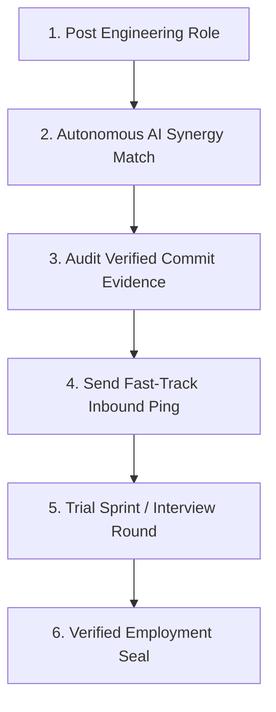

# SkillForge Manual 07: Recruiter Hiring & AI Matching

## 1. Overview
SkillForge provides hiring managers and recruiters with an evidence-based alternative to traditional resumes: candidates are ranked by cryptographic code proof, verified pull requests, and peer ratings.

### Prerequisites
- Active **Recruiter** or **Company Admin** context.
- Available recruiter seat on enterprise workspace.

---

## 2. Click-by-Click Instructions

### Step 1: Posting a Role
1. Navigate to the **"Jobs"** workspace in the left sidebar.
2. Click **"+ Post New Job"**.
3. Select required taxonomy skills (e.g. `React`, `TypeScript`, `Kafka`).
4. Click **"Publish Job"**.

### Step 2: AI Synergy Matching
1. On your published job card, click **"AI Match"** or navigate to **"Talent Search"**.
2. The autonomous ranker computes a match percentage (e.g. `94% Synergy`) based on attested commit history.
3. Filter candidates by availability status (*Available Immediate*, *Two Weeks*, *One Month*).

### Step 3: Fast-Track Outreach
1. Click **"View Dossier"** to audit PR diffs and certificate signatures.
2. Click **"Fast-Track Outreach"**.
3. Enter salary offer range and personalized note. Click **"Send Invitation"**.
4. The inquiry appears directly in the candidate's Inbound Signals radar.

---

## 3. Edge Cases & Error Handling
- **Candidate Privacy**: Candidates with "Recruiter Radar" toggled off in their discovery settings are masked; you can send an anonymous interest ping that they can choose to reveal.
- **Seat Allocation**: If team recruiter seats are exhausted, Company Admins can add additional seats under `/companies?tab=seats`.

---

## 4. Related Flows & Next Steps
- [Manual 08: Company Setup & Sponsored Challenges](./08_company_setup_and_challenges.md)
- [Talent Search Board](/talent)
