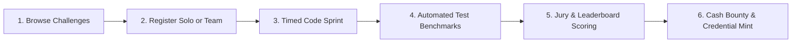

# SkillForge Manual 09: Hackathons & Sprints

## 1. Overview
SkillForge hackathons are high-stakes, time-boxed architectural competitions sponsored by enterprise partners. Participants build verified prototypes, push commit proofs, and compete for prize pools and hiring fast-tracks.

### Prerequisites
- Individual context active with verified profile.
- Team formed within allowed size limits (1–4 members).

---

## 2. Click-by-Click Instructions

### Step 1: Exploring Live Challenges
1. Navigate to **"Challenges & Hackathons"** in the sidebar navigation.
2. Browse active bounties (e.g., `Real-Time Financial Fraud Detection Pipeline`).
3. Click **"View Challenge"** to inspect the prompt, scoring rubric, and prize pool.

### Step 2: Registering a Team
1. Click **"Register Team"**.
2. Invite collaborators or register as a solo builder.
3. Access your dedicated Challenge Project Room before the countdown timer starts.

### Step 3: Submitting Solutions
1. Collaborate in your sprint room, committing code to the verified repository.
2. Before the submission window closes, click **"Submit for Evaluation"**.
3. Automated CI fixtures run unit tests, performance benchmarks, and security audits.

---

## 3. Edge Cases & Error Handling
- **Late Submissions**: The submission portal automatically locks at deadline expiry. Draft commits must be pushed prior to lock.
- **Plagiarism Checks**: Automated AST diff comparison flags duplicated submissions for manual jury audit.

---

## 4. Related Flows & Next Steps
- [Manual 05: Completion, Verification & Certificates](./05_completion_verification_and_certificates.md)
- [Challenges Board](/challenges)
