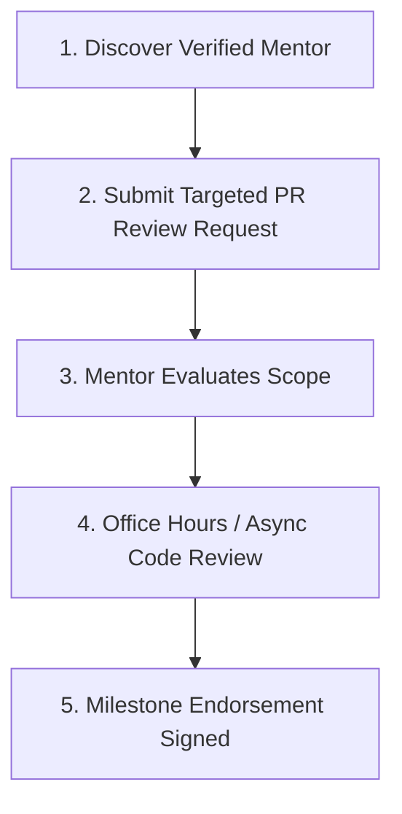

# SkillForge Manual 10: Mentorship & Architectural Advisory

## 1. Overview
The Mentorship ecosystem connects junior and mid-level engineering teams with staff and principal architects for structured PR reviews, office hours, and milestone sign-offs.

### Prerequisites
- Active project with defined technical deliverables.
- Mentor context available for senior advisors.

---

## 2. Click-by-Click Instructions

### Step 1: Requesting Mentorship
1. Navigate to **"Mentors & Advisors"** in the sidebar.
2. Filter mentors by domain expertise (e.g. `Distributed Systems`, `Cloud Infrastructure`).
3. Click **"Request Mentorship"**.
4. Attach your target milestone and specific architectural questions.

### Step 2: Conducting the Advisory Session
1. The mentor receives a notification in their **Requests** tab.
2. Once accepted, schedule an office hour slot or communicate asynchronously in the Project Room.
3. Review line-by-line annotations on pull request diffs.

### Step 3: Milestone Endorsement
1. After recommendations are implemented, the mentor clicks **"Approve & Endorse Milestone"**.
2. A mentor endorsement badge is cryptographically added to the project's permanent audit trail.

---

## 3. Edge Cases & Error Handling
- **Mentor Capacity**: If a mentor's weekly capacity is full, their profile displays an "Office Hours Closed" tag with the date slots reopen.
- **Incompatible Tech Stack**: Mentors can decline requests with an automated referral recommendation to another verified mentor in that domain.

---

## 4. Related Flows & Next Steps
- [Manual 04: Project Room Execution](./04_project_room_execution.md)
- [Mentors & Advisors Workspace](/mentors)
