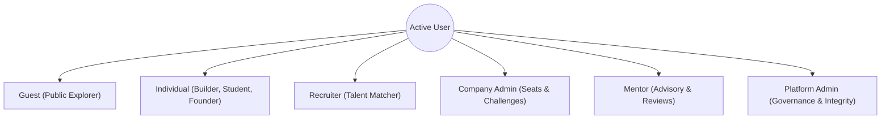
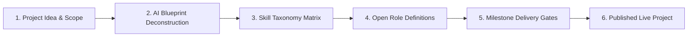
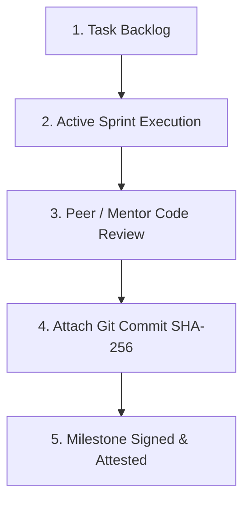
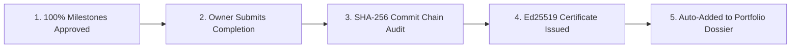
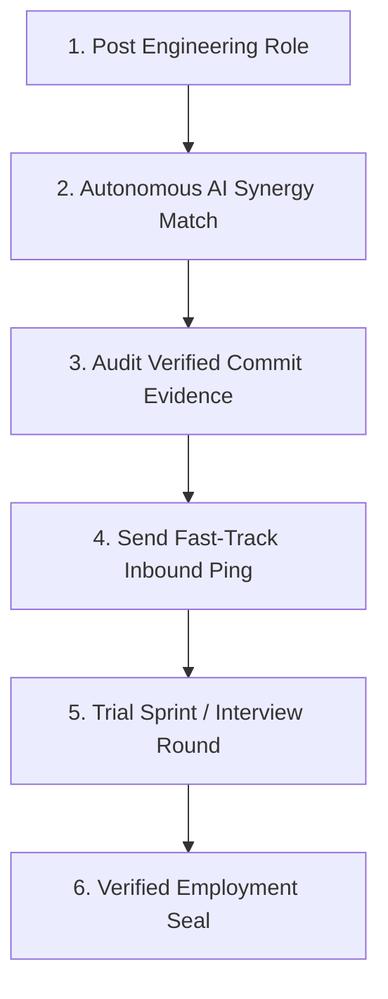
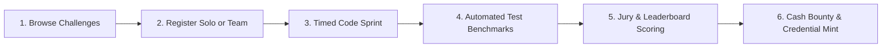
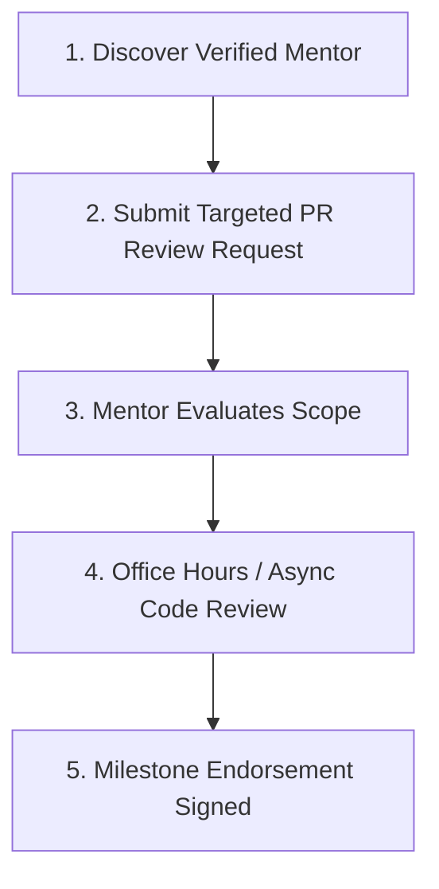

# SkillForge Complete Unified Platform Manual (Parts 1 to 9)

**Product Version**: 3.0 Enterprise Edition  
**Date**: November 2026  
**Status**: Production Verified  

---


<!-- PAGE BREAK -->

# SkillForge Manual 00: Getting Started & The Six Contexts

## 1. Overview & Architecture
SkillForge is a role-aware collaborative engineering and talent verification platform. Rather than forcing users into separate siloed applications, SkillForge organizes your workspace into **Six Distinct Contexts**:



### The Six North Star Contexts
1. **Guest**: Explore public projects, public portfolios, and sign in.
2. **Individual**: Home, Discover, My Projects, Challenges & Hackathons, Portfolio, Inbox.
3. **Recruiter**: Home, Jobs, Talent, Pipeline, Challenges, Messages.
4. **Company Admin**: All Recruiter items + Company (Profile, Seats, Verification) + Analytics.
5. **Mentor**: Home, Requests, Mentored Projects, Feedback, Availability.
6. **Platform Admin**: Overview, Moderation, Verification, Certificates, Skills, Users, Audit, AI Evaluation.

---

## 2. Click-by-Click Instructions

### Switching Contexts in 1 Click
1. Look at the top navigation bar and locate the **Context Switcher** pill (e.g. `Context: Individual`).
2. Click the pill to expand the dropdown of available personas.
3. Select your desired persona (e.g., `"Recruiter"` or `"Mentor"`).
4. The sidebar navigation, home cockpit, and capabilities instantly adapt without reloading the page.

### Navigation Rules
- Every context displays strictly $\le 6$ primary workspaces in the left navigation sidebar.
- Tools and AI intelligence utilities are grouped cleanly under "Tools & Capabilities".
- Secondary utilities (Settings, Help, Search, Notification Bell) reside in the top bar.

---

## 3. Edge Cases & Error Handling
- **Visiting an Unauthorized Route**: If you visit a route belonging to another role (e.g., navigating to `/pipeline` while in Individual context), SkillForge displays a friendly **Access Denied** guard screen with a 1-click button to switch to the required context.
- **Session Persistence**: Your selected active context is saved to `localStorage` and persists across browser refreshes.

---

## 4. Related Flows & Next Steps
- [Manual 01: Onboarding, Profile & Resume Intelligence](./01_onboarding_and_profile.md)
- [Manual 02: Project Creation & AI Requirements Scaffolding](./02_create_project_and_ai_scaffolding.md)


<!-- PAGE BREAK -->

# Chapter 1: Introduction to SkillForge

## Who it is for
All users: Individual Builders, Students, Freelancers, Technical Recruiters, Company Admins, Mentors, and Platform Administrators.

## Time to complete
5 minutes read

## What you will achieve
Understand SkillForge's core vision, how work transforms into verifiable cryptographic proof, how the 6 role contexts function, and the non-negotiable principle of human judgment supported by evidence.

## Before you start
SkillForge is not a typical job board or social network. It is an end-to-end engineering collaboration and credential ecosystem. Every project completed here generates cryptographic proof of what you actually built.

---

## 1. The Core Philosophy
1. **Proof Over Claims**: In traditional hiring, candidates list buzzwords on resumes without proof. In SkillForge, skills are attested through real codebase commits, pull requests, and peer-reviewed project delivery.
2. **AI with Human-in-the-Loop**: AI accelerates requirement generation, resume extraction, and candidate matching, but AI never makes unilateral decisions. You retain 100% control over profile writes, team acceptance, and candidate shortlists.
3. **The Six Contexts**: One person can hold multiple roles (for example, a Senior Distributed Systems Engineer who also mentors projects and recruits for a startup). SkillForge lets you switch between these roles dynamically with zero page reloads.

---

## 2. The Six Contexts Explained

```
+-----------------------------------------------------------------------------------+
|                              SKILLFORGE USER IDENTITY                             |
+-----------------------------------------------------------------------------------+
         |                    |                   |                  |
         v                    v                   v                  v
  [ Individual ]        [ Recruiter ]      [ Company Admin ]     [ Mentor ]
   Build projects,       Source talent,     Manage seats &        Advise teams &
   earn certs &          run AI matching,   post challenges,      review project
   showcase proof        manage pipeline    view analytics        milestones
```

- **Guest**: Public visitors exploring open-source projects, public portfolios, and verifying certificates via QR code.
- **Individual**: Engineers, designers, students, and freelancers who build projects, complete tasks, earn verifiable certificates, and receive inbound career inquiries.
- **Recruiter**: Talent acquisition professionals searching verified engineers based on repository commits and managing candidate pipelines.
- **Company Admin**: Organization leaders managing company profiles, team recruiter seats, enterprise challenges, and hiring analytics.
- **Mentor**: Experienced domain experts providing milestone feedback and architectural guidance to project teams.
- **Platform Admin**: System stewards presiding over verification queues, moderation reports, skill taxonomy curation, and security audit logs.

---

## 3. Platform Terminology (Canonical Glossary)
- **Project**: A collaborative engineering undertaking with defined requirements, milestones, and members.
- **Project Room**: The central workspace containing tasks, milestones, group chat, resources, and telemetry.
- **Task**: An atomic unit of work with status tracking (To Do, In Progress, Review, Done) and commit evidence.
- **Milestone**: A major delivery phase representing verifiable technical progress.
- **Certificate**: An immutable SHA-256 digital credential with a scannable QR code issued to confirmed project contributors.
- **Verified Experience**: A rich portfolio record generated automatically upon project completion detailing technologies used and real code contributions.
- **Skill Gap**: A missing technical capability required by a project that triggers automated talent matching.

---

## What happens next
Proceed to [Chapter 2: Getting Started](./02_getting_started.md) to learn how to navigate your workspace cockpit HUD and switch role contexts.


<!-- PAGE BREAK -->

# SkillForge Manual 02: Project Creation & AI Requirements Scaffolding

## 1. Overview
This manual details the step-by-step process of creating a new collaborative engineering project, decomposing ideas using **Project Blueprint AI**, and structuring delivery milestones.



### Prerequisites
- Active SkillForge session in the **Individual** context.
- High-level concept, problem statement, or target tech stack.

---

## 2. Click-by-Click Instructions

### Step 1: Initiating Project Creation
1. From the top bar or My Projects header, click **"+ Create Project"**.
2. Enter your project title (e.g., `Distributed Consensus & Event Hub`).
3. Select a category (e.g., `Systems & Backend`, `Fullstack Engineering`, `Machine Learning`).

### Step 2: Generating AI Requirements
1. In the **"Problem Statement & Objectives"** textarea, describe your core technical challenges.
2. Click **"Deconstruct into Skill Tree"**.
3. The AI engine automatically generates:
   - Technical architecture overview.
   - Recommended team size (min/max).
   - Core taxonomy skills required (e.g. `Kafka`, `Go`, `Docker`).
   - Milestone schedule with verification gates.

### Step 3: Publishing & Launching
1. Review the open role positions (e.g. `Backend Architect`, `DevOps Lead`).
2. Set visibility to **"Public"** or **"Invite Only"**.
3. Click **"Publish Project & Open Collaboration"**.

---

## 3. Edge Cases & Error Handling
- **Validation Errors**: If the team size is less than 1 or exceeds 10, the form will highlight the field in red before submission.
- **Private Projects**: Private projects can still utilize AI collaborator matching; candidates receive anonymous invitation summaries until accepted.

---

## 4. Related Flows & Next Steps
- [Manual 03: Find & Invite Collaborators](./03_find_and_invite_collaborators.md)
- [Manual 04: Project Room Execution & Milestone Proof](./04_project_room_execution.md)


<!-- PAGE BREAK -->

# Chapter 2: Getting Started with SkillForge

## Who it is for
New users across all role contexts.

## Time to complete
8 minutes

## What you will achieve
Master the 5-zone Home Cockpit HUD, switch role contexts seamlessly, trigger universal search, and replay interactive spotlight tours on demand.

## Before you start
Ensure you are logged into your account. If you do not have an account, complete registration at `/auth/register`.

---

## Step by Step

### The Flow at a Glance
Refer to [FC-01 Platform Master Architecture](./flows/FC-01_Platform_Master.mmd) and [FC-15 Roles and Contexts Map](./flows/FC-15_Roles_and_Contexts_Map.mmd).

---

## 1. The 5-Zone Home Cockpit Layout
Every role context in SkillForge uses the identical, high-contrast 5-zone layout so your environment always feels familiar:

```
+------------------------------------------------------------------------------------+
| ZONE A: Profile & Readiness Header (Avatar, Headline, Score & Quick Actions)       |
+------------------------------------------------------------------------------------+
| ZONE B: Interactive Mini Dashboard (4 Clickable Metric Tiles with Status Rings)    |
+------------------------------------------------------------------------------------+
| ZONE C: Next Best Action Banner (AI Guidance on Urgent Items & Milestones)         |
+------------------------------------------------------------------------------------+
| ZONE D: Workspace Capabilities Grid (6 to 8 Direct Shortcut Feature Cards)         |
+------------------------------------------------------------------------------------+
| ZONE E: Audited Cryptographic Trail & Inbound Opportunity Alerts (Bottom Split)    |
+------------------------------------------------------------------------------------+
```

### Zone A: Profile & Readiness Header
- **Where**: Top banner of `/home`.
- **You will see**: Your full name, verified headline, profile completion ring, and primary action buttons (`+ Create New Project`, `Upload Resume (AI Parse)`).
- **Tip**: Click *Preview Public Dossier* to see exactly how technical recruiters view your attested profile.

### Zone B: Mini Dashboard Stats
- **Where**: Four metric cards directly beneath Zone A.
- **You will see**:
  - *Active Projects*: Total projects you currently own or collaborate on.
  - *Verified Skills*: Number of technical skills attested through real repository commits.
  - *Inbound Signals*: Recruiter inquiries and project invitations awaiting response.
  - *Extractions Ready*: Parsed resumes waiting for your manual review.
- **Action**: Every tile is clickable and immediately filters to the underlying data list.

### Zone C: Next Best Action Strip
- **Where**: Slim contextual guidance banner across the dashboard.
- **You will see**: AI suggestions highlighting overdue milestones, pending teammate invitations, or unverified skills.

### Zone D: Workspace Capabilities & Menu Grid
- **Where**: Central 6-card interactive command grid.
- **You will see**: Shortcuts to Projects & Delivery Hub, Project Blueprint AI, Collaborator Matching, Resume Intelligence, Inbound Opportunities, and Project Health Telemetry.

### Zone E: Recent Actions & Verified Delivery
- **Where**: Bottom split panels.
- **You will see**: Live cryptographic commit proof trail on the left (SHA-256 commit hashes, attestations) and Inbound Signals & Alerts on the right.

---

## 2. Dynamic Role Context Switching
SkillForge allows you to switch between Individual, Recruiter, Company Admin, and Mentor contexts without reloading:
1. Locate the **Context Switcher** in the top navigation bar.
2. Click the active role pill (e.g. `Context: Individual`).
3. Select an alternative available role from the dropdown menu.
4. The sidebar navigation, dashboard metrics, and allowed capabilities update instantly.

---

## 3. Keyboard Shortcuts & Universal Search
- **Universal Search**: Press `Ctrl + K` (or `Cmd + K` on macOS) anywhere on the platform to open global search for projects, people, jobs, and skills.
- **Quick Tour Replay**: Click the `✨ Tour` button in the top navigation bar at any time to relaunch the spotlight walkthrough.
- **Contextual Help**: Click the `?` icon in the top bar to open the in-app help drawer for your current screen.

---

## Field Reference
| Element | Description | Requirement | Limits |
|---|---|---|---|
| Context Switcher | Active role environment | Always active | Maximum 6 primary nav items per role |
| Search Bar | Platform-wide entity search | Optional | Supports keywords, skill tags, project IDs |
| Tour Replay | Relaunches feature walkthrough | Optional | Remembers completion in local storage |

---

## Common Problems & Fixes
- **Problem**: I cannot see the Recruiter or Company Admin option in the Context Switcher.
  - *Cause*: Your account only has Individual membership privileges.
  - *Fix*: Create a company organization at `/companies` or request an invitation from your company admin.
- **Problem**: The notification bell shows an unread count but I cannot find the invite.
  - *Fix*: Navigate to `/team` or `/notifications` and select the *Pending Invitations* filter.

---

## Related Chapters
- [Chapter 3: Profile & Resume Intelligence](./03_profile_and_resume.md)
- [Chapter 4: Project Creation & Scaffolding](./04_project_creation.md)

[Start Guided Welcome Tour](#tour-welcome)


<!-- PAGE BREAK -->

# Chapter 3: Profile Setup, Skills & Resume Intelligence

## Who it is for
Individual Builders, Students, Freelancers, and Technical Candidates.

## Time to complete
10 minutes

## What you will achieve
Upload your existing resume, let SkillForge AI normalize your skills into canonical taxonomy entities, perform mandatory human review before writing to your profile, and configure your privacy visibility.

## Before you start
Prepare your resume file in PDF or DOCX format. Keep it under 10MB.

---

## The Flow at a Glance
Refer to [FC-03 Resume Ingestion, AI Parsing & Profile Normalization](./flows/FC-03_Resume_and_Profile.mmd).

---

## Step by Step Guide

### Step 1: Access Resume Intelligence
- **Where**: Click *Resume Intelligence* in the Zone D home shortcuts or navigate to `/resumes`.
- **You will see**: The Resume Studio upload container with drag-and-drop support.
- **Tip**: You can upload updated versions at any time without losing previous verified skills.

### Step 2: Upload Your Resume File
- **Action**: Drag your resume into the drop zone or click *Browse Files*.
- **You will see**: The extraction pipeline status move from `uploaded` to `parsing` and then `review_ready`.
- **Core Rule**: SkillForge **NEVER** automatically writes extracted information to your public profile without your explicit review.

### Step 3: Mandatory Human-in-the-Loop Review
- **Where**: The side-by-side extraction review drawer.
- **You will see**: Extracted skills, work experience dates, and degrees mapped against canonical taxonomy items.
- **Action**:
  - Adjust proficiency levels (`beginner`, `intermediate`, `expert`).
  - Delete any skill misidentified by the AI parser.
  - Add any missing technologies.
- **Confirmation**: Click the purple *Confirm & Write to Profile* button.

### Step 4: Link Codebase Skill Evidence
- **Where**: Navigate to `/me/profile` under the *Skills* tab.
- **Action**: Next to each skill, click *Attach Evidence* to link a GitHub commit hash, pull request URL, or completed SkillForge project.
- **You will see**: An `Attested` badge appear next to verified skills on your talent graph.

### Step 5: Configure Profile Visibility
- **Where**: In `/settings/privacy` or the top of `/me/profile`.
- **Options**:
  - `Public`: Anyone on the web can view your profile and verified proof.
  - `Registered Users`: Only authenticated SkillForge members can view.
  - `Recruiters Only`: Public cannot see your profile, but verified corporate recruiters can discover you on the Talent Radar.
  - `Private`: Completely hidden from discovery; only members of your active projects can see your details.

---

## Field Reference
| Field | Description | Required | Limits |
|---|---|---|---|
| Resume File | PDF or DOCX resume document | Yes | Max 10MB |
| Skill Name | Canonical technology name (e.g. React, Kafka) | Yes | Validated against taxonomy |
| Proficiency | Self-assessed technical depth | Yes | beginner, intermediate, expert |
| Availability | Current weekly commitment capacity | Yes | available, busy, not_available |
| Visibility | Public discovery policy | Yes | public, registered, recruiters_only, private |

---

## Common Problems & Fixes
- **Problem**: The AI parser mapped my custom framework incorrectly.
  - *Cause*: The technology is an alias or proprietary library not in the canonical taxonomy.
  - *Fix*: Edit the skill name manually during Step 3, or propose a new skill in `/admin/skills`.
- **Problem**: Recruiters are not finding my profile in search.
  - *Cause*: Your profile visibility is set to `Private` or `Registered Users`.
  - *Fix*: Change visibility to `Recruiters Only` or `Public` in `/settings/privacy`.

---

## Related Chapters
- [Chapter 4: Project Creation & Scaffolding](./04_project_creation.md)
- [Chapter 10: Portfolio & Opportunity Discovery](./10_portfolio_and_discovery.md)

[Start Resume Upload Tour](#tour-resume-upload)


<!-- PAGE BREAK -->

# Chapter 4: Launching an Engineering Project & AI Scaffolding

## Who it is for
Project Creators, Team Leads, Technical Founders, and Individual Builders.

## Time to complete
12 minutes

## What you will achieve
Create a collaborative engineering project by describing your concept in plain English, using SkillForge AI to scaffold technical requirements and identify team skill gaps before publishing.

## Before you start
Have a rough problem statement or technical objective in mind. You do not need a fully structured specification—the AI will help deconstruct it.

---

## The Flow at a Glance
Refer to [FC-02 Project Creation to Certification Full Pipeline](./flows/FC-02_Project_Creation_to_Certification.mmd).

---

## Step by Step Guide

### Step 1: Click '+ Create Project'
- **Where**: Top right of Home or Projects page, or navigate to `/projects/create`.
- **You will see**: The Project Creation Wizard form.

### Step 2: Describe Your Idea in Natural Language
- **Action**: Fill in the *Project Title*, select a *Category* (e.g. Systems & Backend, Machine Learning, Fullstack), and describe the problem in the *Problem Statement* field.
- **Tip**: Be specific about the engineering challenge (e.g. "Real-time payment fraud detector with sub-10ms latency using Kafka and graph neural networks").

### Step 3: Trigger AI Requirement Scaffolding
- **Action**: Click the purple *AI Deconstruct Requirements* button (or visit `/ai/requirements`).
- **You will see**:
  - Suggested technical roles (e.g., Lead Architect, Streaming Engineer, ML Ops).
  - Recommended core technologies and proficiency levels.
  - Delivery phase timeline suggestions.

### Step 4: Review and Edit Recommendations (Human Override)
- **Action**: You have complete authority to override AI suggestions:
  - Add or remove specific skills.
  - Change requirement weight from `required` to `preferred`.
  - Set *Min Team Size* (default 1) and *Max Team Size* (default 5).

### Step 5: Inspect the Skill-Gap Analysis
- **Where**: The Skill Gap strip at the bottom of the creation form.
- **You will see**: A clear breakdown of skills:
  - `Covered`: Skills you already possess based on your verified profile.
  - `Partial`: Skills you possess at a lower proficiency than required.
  - `Missing`: Skills your project needs where no current member has verified experience.

### Step 6: Save Draft or Publish for Recruiting
- **Action**: Click *Publish Project*.
- **You will see**: The project status transitions from `Draft` to `Recruiting`, and AI collaborator matching is immediately activated.

---

## Field Reference
| Field | Description | Required | Limits |
|---|---|---|---|
| Title | Public project name | Yes | 5-100 characters |
| Problem Statement | Detailed description of the technical problem | Yes | 20-2000 characters |
| Category | Technical domain | Yes | Select from preset domains |
| Min / Max Team Size | Minimum and maximum collaborator headcount | Yes | 1 to 10 members |
| Target Date | Target milestone completion date | Optional | Future date |
| Visibility | Discovery policy | Yes | Public or Private |

---

## Common Problems & Fixes
- **Problem**: The AI suggested technologies I do not want to use.
  - *Cause*: AI provides generalized recommendations based on typical architectures.
  - *Fix*: Click the trash can icon next to any unwanted requirement and manually add your preferred stack.
- **Problem**: I cannot publish my project.
  - *Cause*: Minimum team size exceeds maximum team size, or required fields are missing.
  - *Fix*: Check that Title, Problem Statement, and valid team bounds are filled.

---

## Related Chapters
- [Chapter 5: Collaborator Matching & Team Formation](./05_team_matching_and_invitations.md)
- [Chapter 6: Project Room Collaboration](./06_project_room_execution.md)

[Start Project Creation Tour](#tour-create-project)


<!-- PAGE BREAK -->

# SkillForge Manual 04: Project Room Execution & Milestone Proof

## 1. Overview
The Project Room is the central collaboration cockpit where teams execute sprints, assign Kanban tasks, share architectural documents, and record cryptographically signed Git commits.



### Prerequisites
- Active project team membership.
- Git repository linked or commit hashes ready for attestation.

---

## 2. Click-by-Click Instructions

### Step 1: Accessing the Project Room
1. In the sidebar, click **"My Projects"**.
2. Locate your active project card and click **"Open Workspace"** or **"Room"**.
3. You enter the multi-tab Project Room with Tasks, Chat, Milestones, and Telemetry.

### Step 2: Managing Tasks & Sprint Velocity
1. Click **"+ Add Task"** to create a technical deliverable.
2. Assign the task to a team member and set a milestone target.
3. Move tasks across the Kanban board columns (*Backlog*, *In Progress*, *Code Review*, *Done*).

### Step 3: Attaching Commit Proof
1. When moving a task to *Done*, click **"Attach Commit Proof"**.
2. Paste the Git commit hash (SHA-256) from your repository.
3. The system verifies commit ownership against your authenticated GitHub identity.

---

## 3. Edge Cases & Error Handling
- **Overdue Milestone Alert**: If milestone completion falls behind schedule by 7+ days, the status beacon turns yellow, notifying team members on their Home cockpit.
- **Unverified Commits**: Commits authored under emails not verified on your SkillForge account cannot be used for cryptographic skill attestation.

---

## 4. Related Flows & Next Steps
- [Manual 05: Completion, Verification & Certificates](./05_completion_verification_and_certificates.md)
- [Manual 06: Project Rescue & Velocity Recovery](./06_project_rescue.md)


<!-- PAGE BREAK -->

# SkillForge Manual 05: Completion, Verification & Certificates

## 1. Overview
When all project milestones are completed, the project owner seals the project. SkillForge audits the commit ledger and issues an immutable, verifiable completion certificate.



### Prerequisites
- All milestones in the project marked as approved.
- All team member contributions recorded.

---

## 2. Click-by-Click Instructions

### Step 1: Submitting Project Completion
1. In the Project Room, open the **"Certification"** tab.
2. Review the summary of approved milestones, total commits, and member contribution shares.
3. Click **"Complete Project & Issue Credentials"**.

### Step 2: Cryptographic Signature & Issuance
1. The backend signs the completion record using the SkillForge root Ed25519 key.
2. A unique Certificate ID (e.g., `CERT-SF-2026-9041`) is minted.
3. Every contributing team member automatically receives their credential in **"Certificates"**.

### Step 3: Public Verification
1. Click **"View Public Certificate"** or visit `/verify/:certId`.
2. The verification page confirms the authenticity, commit chain hashes, and taxonomy skills attested.

---

## 3. Edge Cases & Error Handling
- **Revocation**: If fraudulent activity or plagiarized code is detected, Platform Admins can revoke a certificate; the public verification page will immediately show a red "Revoked" alert.
- **Missing Commits**: If a member has zero verified commits attached, they receive an advisory contribution certificate rather than a full engineering completion seal.

---

## 4. Related Flows & Next Steps
- [Manual 07: Recruiter Hiring & AI Matching](./07_recruiter_hiring_and_ai_matching.md)
- [Public Dossier Verification Page](/verify)


<!-- PAGE BREAK -->

# Chapter 5: Collaborator Matching, Invitations & Team Assembly

## Who it is for
Project Owners looking for builders, and Individual Contributors seeking projects to join.

## Time to complete
10 minutes

## What you will achieve
Find complementary collaborators using SkillForge's explainable AI matching engine, issue role-specific invitations, handle inbound join requests, and establish mutual consent before work begins.

## Before you start
Publish an engineering project (status: `Recruiting`) or have a completed profile ready for discovery.

---

## The Flow at a Glance
Refer to [FC-04 AI Collaborator Matching & Team Assembly Flow](./flows/FC-04_Matching_and_Team_Formation.mmd).

---

## Step by Step Guide

### Step 1: Open Collaborator Matching
- **Where**: Inside your project under the *Team* tab, or visit `/ai/match`.
- **You will see**: Candidate cards ranked by a percentage synergy score (0-100%).

### Step 2: Understand the Synergy Breakdown (Explainability)
- **Action**: Click *Why this match?* on any candidate card.
- **You will see**: An explainable breakdown rather than a black-box number:
  - *Skill Overlap*: Identifies which of your project's missing gaps this candidate covers.
  - *Timezone Compatibility*: Evaluates working hour overlap.
  - *Past Evidence*: Cites verified commit history or completion certificates.

### Step 3: Issue a Role-Specific Invitation
- **Action**: Click *Invite to Project*.
- **Where**: The invitation modal.
- **You will see**: Options to select the specific role opening (e.g. "Distributed Systems Engineer") and append a personalized orientation note.
- **Dispatch**: The candidate immediately receives an alert in their notifications and inbox.

### Step 4: The Candidate Experience (Responding to Invites)
- **Where**: In `/notifications` or `/team` under *My Invitations*.
- **You will see**: The project title, problem statement, required role, and owner's note.
- **Action**: Click *Accept* or *Decline*.
- **Expiry Rule**: Invitations automatically expire after 7 days if unresponded to ensure teams do not remain stalled.

### Step 5: Handling Inbound Join Requests
- **Where**: Project *Team* tab under *Join Requests*.
- **Action**: Review incoming requests submitted by developers who found your project on the Discover feed.
- **Decision**: Click *Approve* to assign their role, or *Decline* with optional feedback.

### Step 6: Team Formation & Activation
- **Outcome**: Once minimum team size is satisfied and mutual consent is recorded, the project status automatically transitions to `Active`.

---

## Field Reference
| Field | Description | Required | Limits |
|---|---|---|---|
| Role Title | Title assigned to collaborator | Yes | E.g. Frontend Lead, ML Ops |
| Invitation Note | Personal message from project owner | Optional | Max 500 characters |
| Invitation Status | Lifecycle state of the invitation | System | pending, accepted, declined, expired |

---

## Common Problems & Fixes
- **Problem**: Candidate cannot see my project invitation.
  - *Cause*: Candidate has muted project notifications or invitation expired.
  - *Fix*: Check `/team` in your project to see if the invitation is marked `expired`. If so, re-send the invite.
- **Problem**: The project remains in 'Recruiting' even though members joined.
  - *Cause*: The number of confirmed members is below your configured `Min Team Size`.
  - *Fix*: Invite additional collaborators or lower the minimum team size in Project Details.

---

## Related Chapters
- [Chapter 6: Project Room Collaboration](./06_project_room_execution.md)
- [Chapter 8: Project Rescue & Emergency Handover](./08_project_rescue.md)

[Start Team Matching Tour](#tour-find-collaborators)


<!-- PAGE BREAK -->

# Chapter 6: Project Room Collaboration & Delivery Execution

## Who it is for
Project Owners, Team Members, and Assigned Mentors.

## Time to complete
15 minutes

## What you will achieve
Run your engineering sprint using the Project Room: organize tasks on a Kanban board, link pull request evidence, track delivery milestones, use group and direct chat, and monitor project health telemetry.

## Before you start
Have an active project (status: `Active`) with at least one confirmed collaborator.

---

## The Flow at a Glance
Refer to [FC-05 Project Room Execution & Contribution Loop](./flows/FC-05_Project_Room_Loop.mmd).

---

## Step by Step Guide

### Step 1: Open the Project Room
- **Where**: Click *Projects & Delivery Hub* from Home or navigate to `/projects/:id`.
- **You will see**: The Project Room navigation tabs: *Overview*, *Team*, *Tasks*, *Milestones*, *Contributions*, *Resources*, *Discussions*, and *Analytics*.

### Step 2: Organize Work on the Kanban Board
- **Where**: The *Tasks* tab.
- **Action**:
  - Click `+ New Task`. Enter Title, Description, Milestone linkage, Priority (`Low`, `Medium`, `High`, `Urgent`), and Assignee.
  - Drag task cards across columns: `To Do` -> `In Progress` -> `Review` -> `Done`.
  - When moving to `Review`, paste your GitHub commit hash or pull request link.

### Step 3: Track Milestones & Delivery Velocity
- **Where**: The *Milestones* tab.
- **You will see**: The chronological timeline of milestones with individual progress bars calculated from completed linked tasks.
- **Action**: When all linked tasks reach `Done`, the milestone lead marks the milestone `Under Review` for owner approval.

### Step 4: Real-Time Team Communication
- **Where**: The *Discussions* tab (or `/chat/:id`).
- **You will see**:
  - *Group Chat*: Public to all confirmed project members. Share code snippets, architecture diagrams, and sprint goals.
  - *Direct Messages*: Private 1:1 channels between collaborators.
  - *Meeting Notes*: Structured repository of sprint sync notes, action items, and technical decisions.

### Step 5: Monitor Project Health Telemetry
- **Where**: The *Analytics* tab or the project header health pill.
- **You will see**: Real-time automated health indicators:
  - `Healthy`: Normal task velocity, active commits, milestones on schedule.
  - `At Risk`: One or more tasks overdue by >5 days, or low commit activity.
  - `Needs Attention`: Milestone deadline breached or key contributor inactive.
- **Recommended Action**: If health drops, the system recommends reallocating tasks or initiating a Project Rescue.

---

## Field Reference
| Field | Description | Required | Limits |
|---|---|---|---|
| Task Title | Description of work item | Yes | 3-120 characters |
| Task Priority | Urgency ranking | Yes | Low, Medium, High, Urgent |
| Assignee | Assigned team member | Optional | Must be confirmed project member |
| Milestone Name | Objective title | Yes | E.g. MVP Core, API Integration |
| Target Date | Due date for milestone | Yes | Future date |

---

## Common Problems & Fixes
- **Problem**: Moving a task to 'Done' does not increase milestone progress.
  - *Cause*: The task was not associated with that specific milestone when created.
  - *Fix*: Click the task to edit it, select the milestone from the dropdown, and save.
- **Problem**: Project health displays 'At Risk' even though we are actively coding.
  - *Cause*: GitHub integration is not linked, so commits are not being streamed to the platform telemetry.
  - *Fix*: Connect your repository in the *GitHub* tab (see Chapter 7).

---

## Related Chapters
- [Chapter 7: GitHub & Contribution Evidence](./07_github_and_contributions.md)
- [Chapter 8: Project Rescue & Emergency Handover](./08_project_rescue.md)

[Start Project Room Tour](#tour-project-room)


<!-- PAGE BREAK -->

# Chapter 7: GitHub Integration & Contribution Evidence

## Who it is for
Individual Contributors, Team Leads, and Project Owners.

## Time to complete
8 minutes

## What you will achieve
Link your project to a GitHub repository, automatically stream commit logs and pull requests into your contribution ledger, and generate verifiable cryptographic evidence for each team member.

## Before you start
Ensure you have a GitHub account and administrative or contributor access to the repository you want to link.

---

## The Flow at a Glance
Refer to [FC-05 Project Room Execution & Contribution Loop](./flows/FC-05_Project_Room_Loop.mmd).

---

## Step by Step Guide

### Step 1: Connect GitHub via OAuth
- **Where**: Navigate to `/integrations/github` or the *GitHub* tab inside your project.
- **Action**: Click *Connect GitHub Account*.
- **You will see**: The standard GitHub authorization dialog requesting read access to repositories and commit metadata.
- **Safety**: SkillForge requests minimal read permissions; it never requests write access or personal repository deletion rights.

### Step 2: Link Repository to Your SkillForge Project
- **Where**: In the Project Room *GitHub* panel.
- **Action**: Select the target repository from the dropdown menu (or enter the repository full path `owner/repo-name`).
- **Confirmation**: Click *Link Repository*.
- **Sync**: The integration immediately indexes repository commit history, branches, and merged pull requests.

### Step 3: Automated Contribution Evidence Extraction
- **Action**: When team members push commits or merge pull requests, SkillForge matches the git author email to confirmed team member profiles.
- **You will see**: Real-time commits appear under the *Contributions* tab:
  - Commit SHA-256 hash.
  - Number of lines added / deleted.
  - Linked task ID (if the commit message included `#task-id`).

### Step 4: Reviewing Your Contribution Profile
- **Where**: Inside the project *Contributions* tab.
- **You will see**: A breakdown per member:
  - Total commits contributed.
  - Core technologies touched (e.g. TypeScript, Kafka, Docker).
  - Peer-attested review score.

### Step 5: Handling Wrong Attributions & Disputes
- **Action**: If a commit is attributed to the wrong member or missing:
  1. Click *Contest Attribution* next to the commit entry.
  2. Provide the correct git author email or co-author metadata.
  3. The project owner or team consensus reviews and confirms the correction.

---

## Field Reference
| Field | Description | Required | Limits |
|---|---|---|---|
| Repository Name | Full GitHub repo identifier (`org/repo`) | Yes | Valid public or authorized private repo |
| Commit Hash | SHA-1 or SHA-256 commit identifier | System | 40-character hex string |
| Linked Task | Associated Kanban task ID | Optional | Must exist in current project |

---

## Common Problems & Fixes
- **Problem**: My commits are not showing up under my name.
  - *Cause*: The email address configured in your local git client (`git config user.email`) does not match your SkillForge account email.
  - *Fix*: Add your git email as an alias in `/auth/settings`, or link the commits manually with task IDs.
- **Problem**: Synchronization appears paused.
  - *Cause*: GitHub OAuth token expired or rate limit reached.
  - *Fix*: Click *Re-sync Repository* in the GitHub panel to refresh the OAuth token.

---

## Related Chapters
- [Chapter 6: Project Room Collaboration](./06_project_room_execution.md)
- [Chapter 9: Project Completion & Certification](./09_completion_and_certification.md)

[Start GitHub Integration Tour](#tour-github-evidence)


<!-- PAGE BREAK -->

# SkillForge Manual 07: Recruiter Hiring & AI Matching

## 1. Overview
SkillForge provides hiring managers and recruiters with an evidence-based alternative to traditional resumes: candidates are ranked by cryptographic code proof, verified pull requests, and peer ratings.



### Prerequisites
- Active **Recruiter** or **Company Admin** context.
- Available recruiter seat on enterprise workspace.

---

## 2. Click-by-Click Instructions

### Step 1: Posting a Role
1. Navigate to the **"Jobs"** workspace in the left sidebar.
2. Click **"+ Post New Job"**.
3. Select required taxonomy skills (e.g. `React`, `TypeScript`, `Kafka`).
4. Click **"Publish Job"**.

### Step 2: AI Synergy Matching
1. On your published job card, click **"AI Match"** or navigate to **"Talent Search"**.
2. The autonomous ranker computes a match percentage (e.g. `94% Synergy`) based on attested commit history.
3. Filter candidates by availability status (*Available Immediate*, *Two Weeks*, *One Month*).

### Step 3: Fast-Track Outreach
1. Click **"View Dossier"** to audit PR diffs and certificate signatures.
2. Click **"Fast-Track Outreach"**.
3. Enter salary offer range and personalized note. Click **"Send Invitation"**.
4. The inquiry appears directly in the candidate's Inbound Signals radar.

---

## 3. Edge Cases & Error Handling
- **Candidate Privacy**: Candidates with "Recruiter Radar" toggled off in their discovery settings are masked; you can send an anonymous interest ping that they can choose to reveal.
- **Seat Allocation**: If team recruiter seats are exhausted, Company Admins can add additional seats under `/companies?tab=seats`.

---

## 4. Related Flows & Next Steps
- [Manual 08: Company Setup & Sponsored Challenges](./08_company_setup_and_challenges.md)
- [Talent Search Board](/talent)


<!-- PAGE BREAK -->

# Chapter 8: Project Rescue & Emergency Handover

## Who it is for
Project Owners facing collaborator inactivity, and Incoming Replacement Engineers taking over stalled projects.

## Time to complete
10 minutes

## What you will achieve
Recover a stalled or abandoned project by declaring an emergency skill gap, writing a structured handover brief, sourcing replacement talent, and preserving prior contributors' commit history without losing momentum.

## Before you start
Identify which role or technical component is blocked. If an inactive member has been unresponsive for >7 days, document the affected tasks.

---

## The Flow at a Glance
Refer to [FC-06 Project Rescue & Skill-Gap Replacement Architecture](./flows/FC-06_Rescue_a_Stalled_Project.mmd).

---

## Step by Step Guide

### Step 1: Detect Stalled Milestones or Inactive Members
- **Where**: The Project Room header banner or `/ai/health`.
- **You will see**: If telemetry detects zero commits or overdue tasks for >10 days, a red alert banner appears: *Project Stalled: Rescue Recommended*.

### Step 2: Declare an Emergency Project Gap
- **Where**: Project Details under *Team* -> *Project Rescue* (or `/projects/:id/rescue`).
- **Action**: Click *Declare Gap*.
- **You will see**: The Gap Wizard modal prompting for:
  - Role Title (e.g. "Replacement Backend Lead").
  - Trigger Reason (`member_left`, `inactive`, `skill_deficit`).
  - Priority (`High`, `Urgent`).

### Step 3: Write the Context-First Handover Note
- **Action**: Fill in the Handover Brief:
  - *Current State*: What is working and what is broken in the codebase.
  - *Immediate Next Tasks*: What the replacement engineer must complete in their first 48 hours.
  - *Architectural Pitfalls*: Key blockers to avoid.
- **Why this matters**: Replacement developers are 5x more likely to accept a rescue project if they receive clear orientation notes upfront.

### Step 4: Dispatch Urgent Replacement Invitations
- **Action**: SkillForge AI filters candidates marked as *Available for Immediate Rescue Work*.
- **You will see**: Candidates ranked by exact match to the unblocked technologies.
- **Dispatch**: Click *Send Rescue Invitation*. The invite includes the full handover brief so the candidate knows exactly what they are stepping into.

### Step 5: Handover Acceptance & Work Resumption
- **Action**: The replacement engineer clicks *Accept Rescue*.
- **System Actions**:
  - Orphaned tasks are automatically transferred to the incoming engineer.
  - The departed member's prior commits and PRs remain permanently credited to them.
  - Project health telemetry recalculates and returns to `Healthy`.

---

## Field Reference
| Field | Description | Required | Limits |
|---|---|---|---|
| Gap Role | Title of replacement position | Yes | 3-50 characters |
| Trigger Reason | Reason for replacement | Yes | member_left, inactive, manual |
| Handover Summary | High-level status of the codebase | Yes | 20-1000 characters |
| Immediate Deliverables | Concrete tasks to be completed first | Yes | At least one item |

---

## Common Problems & Fixes
- **Problem**: Does the departed member lose credit for their previous commits?
  - *Answer*: **No**. SkillForge strictly adheres to the Immutable Attribution rule. Any commit SHA pushed prior to departure remains cryptographically linked to the departed member's profile.
- **Problem**: Candidates are declining the rescue invitation.
  - *Cause*: The handover brief does not provide enough technical context or specifies an unrealistic deadline.
  - *Fix*: Edit the handover note in `/projects/:id/rescue` to clarify the architecture and extend the milestone date.

---

## Related Chapters
- [Chapter 6: Project Room Collaboration](./06_project_room_execution.md)
- [Chapter 9: Project Completion & Certification](./09_completion_and_certification.md)

[Start Project Rescue Tour](#tour-rescue-project)


<!-- PAGE BREAK -->

# Chapter 9: Project Completion, Verification & Certificates

## Who it is for
Project Creators, Team Collaborators, Technical Evaluators, and Verifiers.

## Time to complete
12 minutes

## What you will achieve
Guide your finished project through formal completion: verify deliverables, collect unanimous peer confirmations, submit for cryptographic verification, and receive an immutable digital certificate with a public QR code.

## Before you start
Ensure all planned milestones are completed and all code is merged into your linked GitHub repository.

---

## The Flow at a Glance
Refer to [FC-07 Project Completion, Cryptographic Verification & Public Credentials](./flows/FC-07_Completion_Verification_and_Certificate.mmd).

---

## Step by Step Guide

### Step 1: Submit the Completion Checklist
- **Where**: Project *Overview* or the *Certification* tab.
- **Action**: Click *Request Project Completion*.
- **You will see**: The formal completion checklist modal prompting for:
  - Live Demo URL (e.g. Vercel, Railway, or Docker repository).
  - Final Production GitHub Release / Commit SHA.
  - Final Architecture Summary & Outcomes achieved.
- **Locking**: Submitting the checklist temporarily locks the Project Room to capture a frozen snapshot of evidence.

### Step 2: Unanimous Peer Confirmation
- **Where**: Every confirmed member receives an urgent confirmation alert in Zone E of their Home dashboard.
- **Action**: Each collaborator reviews the final deliverable summary and clicks *Confirm My Contributions & Role*.
- **Consensus Rule**: 100% of confirmed active members must vote to approve before the project advances.

### Step 3: Handling Attribution Disputes
- **Action**: If any collaborator clicks *Dispute Attributions*:
  1. The project state transitions to `Disputed`.
  2. The issue routes automatically to the Platform Admin Mediation Queue (see Chapter 14).
  3. An administrator inspects commit logs and mediates role adjustments.

### Step 4: Verification Engine (Automated vs Admin)
- **Fast-Track Auto-Verification**: If a project has:
  - More than 10 verified git commits.
  - All milestones marked complete with task history.
  - Unanimous peer approval.
  The platform auto-approves verification in seconds.
- **Admin Review**: Flagged projects, sponsored challenges, and high-value bounty projects route to an admin for code audit.

### Step 5: Cryptographic Certificate Minting
- **Outcome**: The moment verification passes:
  - An immutable SHA-256 certificate is minted for **EVERY** confirmed member.
  - A unique scannable QR code and public URL are generated (`/verify/:certId`).
  - The project automatically becomes a *Verified Project Experience* card on each member's portfolio.

---

## Field Reference
| Field | Description | Required | Limits |
|---|---|---|---|
| Live Demo URL | Publicly accessible production link | Yes | Valid HTTPS URL |
| Final Commit SHA | Git commit hash of final release | Yes | 40-char hex string |
| Certificate UUID | Unique credential identifier | System | Immutable UUID |
| Public Verify URL | Public link for recruiters to audit proof | System | `https://skillforge.dev/verify/:certId` |

---

## Common Problems & Fixes
- **Problem**: One team member is unreachable and cannot click 'Confirm'.
  - *Cause*: Unresponsive member blocks the 100% consensus requirement.
  - *Fix*: If a member has been inactive for >14 days, the owner can initiate an inactivity removal request, which routes to admin resolution.
- **Problem**: Can a certificate be revoked?
  - *Answer*: **Yes**. If plagiarism, code tampering, or academic fraud is subsequently proven, an administrator can revoke the certificate, which immediately marks the public QR page as `Revoked` (see Chapter 14).

---

## Related Chapters
- [Chapter 7: GitHub & Contribution Evidence](./07_github_and_contributions.md)
- [Chapter 10: Portfolio & Opportunity Discovery](./10_portfolio_and_discovery.md)

[Start Completion & Verification Tour](#tour-complete-verify)


<!-- PAGE BREAK -->

# SkillForge Manual 09: Hackathons & Sprints

## 1. Overview
SkillForge hackathons are high-stakes, time-boxed architectural competitions sponsored by enterprise partners. Participants build verified prototypes, push commit proofs, and compete for prize pools and hiring fast-tracks.



### Prerequisites
- Individual context active with verified profile.
- Team formed within allowed size limits (1–4 members).

---

## 2. Click-by-Click Instructions

### Step 1: Exploring Live Challenges
1. Navigate to **"Challenges & Hackathons"** in the sidebar navigation.
2. Browse active bounties (e.g., `Real-Time Financial Fraud Detection Pipeline`).
3. Click **"View Challenge"** to inspect the prompt, scoring rubric, and prize pool.

### Step 2: Registering a Team
1. Click **"Register Team"**.
2. Invite collaborators or register as a solo builder.
3. Access your dedicated Challenge Project Room before the countdown timer starts.

### Step 3: Submitting Solutions
1. Collaborate in your sprint room, committing code to the verified repository.
2. Before the submission window closes, click **"Submit for Evaluation"**.
3. Automated CI fixtures run unit tests, performance benchmarks, and security audits.

---

## 3. Edge Cases & Error Handling
- **Late Submissions**: The submission portal automatically locks at deadline expiry. Draft commits must be pushed prior to lock.
- **Plagiarism Checks**: Automated AST diff comparison flags duplicated submissions for manual jury audit.

---

## 4. Related Flows & Next Steps
- [Manual 05: Completion, Verification & Certificates](./05_completion_verification_and_certificates.md)
- [Challenges Board](/challenges)


<!-- PAGE BREAK -->

# SkillForge Manual 10: Mentorship & Architectural Advisory

## 1. Overview
The Mentorship ecosystem connects junior and mid-level engineering teams with staff and principal architects for structured PR reviews, office hours, and milestone sign-offs.



### Prerequisites
- Active project with defined technical deliverables.
- Mentor context available for senior advisors.

---

## 2. Click-by-Click Instructions

### Step 1: Requesting Mentorship
1. Navigate to **"Mentors & Advisors"** in the sidebar.
2. Filter mentors by domain expertise (e.g. `Distributed Systems`, `Cloud Infrastructure`).
3. Click **"Request Mentorship"**.
4. Attach your target milestone and specific architectural questions.

### Step 2: Conducting the Advisory Session
1. The mentor receives a notification in their **Requests** tab.
2. Once accepted, schedule an office hour slot or communicate asynchronously in the Project Room.
3. Review line-by-line annotations on pull request diffs.

### Step 3: Milestone Endorsement
1. After recommendations are implemented, the mentor clicks **"Approve & Endorse Milestone"**.
2. A mentor endorsement badge is cryptographically added to the project's permanent audit trail.

---

## 3. Edge Cases & Error Handling
- **Mentor Capacity**: If a mentor's weekly capacity is full, their profile displays an "Office Hours Closed" tag with the date slots reopen.
- **Incompatible Tech Stack**: Mentors can decline requests with an automated referral recommendation to another verified mentor in that domain.

---

## 4. Related Flows & Next Steps
- [Manual 04: Project Room Execution](./04_project_room_execution.md)
- [Mentors & Advisors Workspace](/mentors)


<!-- PAGE BREAK -->

# Chapter 10: Professional Portfolio & Opportunity Discovery

## Who it is for
Individual Developers, Freelancers, Job Seekers, and Candidates.

## Time to complete
8 minutes

## What you will achieve
Customize your public engineering dossier, showcase verified project cards, generate a shareable vanity URL with embedded proof badges, and discover matching career opportunities.

## Before you start
Complete your profile details or have at least one verified experience card minted from a completed project.

---

## The Flow at a Glance
Refer to [FC-12 Individual Opportunity Discovery & Career Inbound](./flows/FC-12_Opportunities_for_Individuals.mmd) and [FC-16 Privacy Boundaries](./flows/FC-16_Who_Can_See_My_Data.mmd).

---

## Step by Step Guide

### Step 1: Open the Portfolio Editor
- **Where**: Under *My Portfolio* in the navigation bar or navigate to `/me/portfolio`.
- **You will see**: The interactive portfolio customizer with a live split-screen preview.

### Step 2: Organize Your Verified Project Cards
- **Action**:
  - Reorder project cards using drag handles to highlight your strongest engineering work.
  - Pin up to 3 *Featured Projects* to the top of your public showcase.
  - Toggle individual project visibility (e.g., hide early learning projects, showcase production MVPs).

### Step 3: Embed Verifiable Cryptographic Badges
- **You will see**: Verified cards display an attested green badge:
  - Total confirmed repository commits.
  - Specific technologies used in production (e.g. `Kafka (Advanced)`, `Docker`).
  - One-click link to the public verification certificate (`/verify/:certId`).

### Step 4: Share Your Public Vanity URL
- **Where**: Top right of `/me/portfolio`.
- **Action**: Copy your public URL (format: `https://skillforge.dev/u/:username` or `/portfolio/:username`).
- **Use case**: Paste this link into your resume, GitHub profile, LinkedIn, or send directly to hiring managers.

### Step 5: Discovering Career Opportunities
- **Where**: Navigate to the Discover hub at `/discover` or `/feed`.
- **Tabs**:
  - *Projects Seeking Skills*: Browse collaborative teams that have active gaps matching your exact verified technologies.
  - *Full-Time Jobs*: Corporate engineering openings posted by verified tech companies.
  - *Hackathons & Sprints*: Time-boxed weekend challenges with cash bounties.
- **Action**: Click *Save* to bookmark an opportunity, or *Express Interest* to share your verified dossier with the hiring team.

---

## Field Reference
| Field | Description | Required | Limits |
|---|---|---|---|
| Vanity Username | Custom URL slug (`/u/username`) | Yes | 3-30 alphanumeric characters |
| Bio Headline | Professional engineering specialty | Yes | Max 100 characters |
| Featured Projects | Top highlighted projects | Optional | Max 3 pinned cards |
| Inbound Status | Open to recruiter discussions | Yes | Active / Paused |

---

## Common Problems & Fixes
- **Problem**: When recruiters visit my link, they see 'Profile Not Found'.
  - *Cause*: Your portfolio visibility is set to `Private` or `Registered Users Only`.
  - *Fix*: In `/settings/privacy`, change *Portfolio Visibility* to `Public`.
- **Problem**: A project I completed is not appearing in my portfolio editor.
  - *Cause*: The project completion checklist is still awaiting peer confirmation from teammates.
  - *Fix*: Check the project certification status at `/projects/:id` to verify all members have signed off.

---

## Related Chapters
- [Chapter 9: Project Completion & Certification](./09_completion_and_certification.md)
- [Chapter 12: Recruiter Radar & Hiring Pipeline](./12_recruiters_and_companies.md)

[Start Portfolio Tour](#tour-portfolio)


<!-- PAGE BREAK -->

# Chapter 11: Hackathons, Sprints & Sponsored Company Challenges

## Who it is for
Individual Developers, Competitive Hackathon Teams, and Enterprise Challenge Sponsors.

## Time to complete
10 minutes

## What you will achieve
Participate in rapid 48-hour engineering hackathons with live sprint countdowns, solve sponsored enterprise challenges, and earn company-endorsed verified credentials.

## Before you start
Ensure your profile has at least 3 declared skills and that you have connected your GitHub account.

---

## The Flow at a Glance
Refer to [FC-08 Hackathon & Rapid 48-Hour Sprint Lifecycle](./flows/FC-08_Hackathon_or_Sprint.mmd) and [FC-09 Company-Sponsored Real-World Challenge Architecture](./flows/FC-09_Company_Challenge.mmd).

---

## Step by Step

### Part 1: Hackathons & Sprint Mode

### Step 1: Browse Upcoming Hackathons
- **Where**: Under *Challenges & Hackathons* in the sidebar or navigate to `/hackathons`.
- **You will see**: Event cards listing theme, countdown timer, prize pool, and registration deadline.

### Step 2: Register & Rapid Teammate Matching
- **Action**: Click *Register for Hackathon*.
- **Solo vs Team**:
  - If you already have a team, enter your team name.
  - If you are solo, select *Find Me Teammates*. SkillForge's rapid matcher groups you with complementary builders based on backend, frontend, and design skill overlap.

### Step 3: 48-Hour Sprint Room Execution
- **You will see**: The specialized Sprint Room with:
  - Live clock counting down to the hard deadline.
  - Expedited 3-milestone structure: `Architecture MVP`, `Core Logic & API`, `Polish & Demo`.
  - Automated continuous GitHub commit tracking.

### Step 4: Final Submission & Judging
- **Action**: Before the timer expires, submit your GitHub release tag, live deployment link, and 2-minute video walkthrough.
- **Outcome**: Submissions are scored by technical judges; valid projects receive official Hackathon Sprint Certificates.

---

## Part 2: Sponsored Company Challenges

### Step 1: Browse Enterprise Challenges
- **Where**: Navigate to `/challenges`.
- **You will see**: Verified company challenges (e.g., "Build a Low-Latency Fraud Detection Pipeline", "Zero-Knowledge Proof Verifier").
- **Rewards**: Cash bounties, enterprise software grants, or direct interview fast-tracks.

### Step 2: Launch Challenge Workspace
- **Action**: Click *Take on Challenge*.
- **You will see**: A dedicated challenge workspace initialized with the company's architectural constraints and test suites.

### Step 3: Company Review & Hiring Fast-Track
- **Action**: The sponsoring company's engineering team audits your code, test coverage, and architecture.
- **Outcome**: Teams with high scores receive:
  - Cash prize payout.
  - Company-endorsed Verified Experience badge on their portfolio.
  - Direct fast-track into the company's senior engineering interview pipeline.

---

## Field Reference
| Field | Description | Required | Limits |
|---|---|---|---|
| Hackathon Team Name | Unique team identifier | Yes | 3-30 characters |
| Demo Video URL | Loom, YouTube, or MP4 link | Yes | Max 3 minutes |
| Submission Repo | Linked GitHub repository | Yes | Must contain public commits |

---

## Common Problems & Fixes
- **Problem**: I missed the 48-hour submission deadline.
  - *Cause*: Hackathon countdown timers strictly lock submissions at `00:00:00`.
  - *Fix*: You can still convert the workspace into a standard public project at `/projects/create` and complete it via the normal certification pipeline.

---

## Related Chapters
- [Chapter 4: Project Creation & Scaffolding](./04_project_creation.md)
- [Chapter 9: Project Completion & Certification](./09_completion_and_certification.md)

[Start Hackathons Tour](#tour-hackathons)


<!-- PAGE BREAK -->

# Chapter 12: Recruiter Radar, AI Candidate Matching & Hiring Pipeline

## Who it is for
Technical Recruiters, Engineering Hiring Managers, and Company Administrators.

## Time to complete
15 minutes

## What you will achieve
Set up your company profile, post jobs with required taxonomy skills, search verified engineers using commit-based evidence, compare candidates side-by-side, and manage prospects across an 8-stage hiring pipeline.

## Before you start
Switch your active role context to **Recruiter** or **Company Admin** using the top-bar Context Switcher.

---

## The Flow at a Glance
Refer to [FC-11 Recruiter Talent Radar, AI Matching & Hiring Pipeline](./flows/FC-11_Hiring_Pipeline.mmd).

---

## Step by Step Guide

### Step 1: Set Up & Verify Your Company Profile
- **Where**: Switch to *Company Admin* and navigate to `/companies`.
- **Action**:
  - Fill in Company Name, Logo, Website, and Engineering Overview.
  - Upload corporate verification proof (e.g. corporate email domain, business registration).
  - Invite technical recruiters to team seats.

### Step 2: Post a Job Opening
- **Where**: Under *Jobs* in the navigation bar or navigate to `/jobs`.
- **Action**: Click `+ Post New Job`.
- **Fill Details**:
  - *Job Title*: E.g., "Senior Distributed Systems Engineer".
  - *Location & Work Mode*: `remote`, `hybrid`, `onsite`.
  - *Required Skills*: Select from canonical taxonomy (e.g. `Kafka`, `Go`, `Docker`).
  - *Compensation Range*: Base salary range and equity options.
- **Publish**: State moves to `Active`. Candidates can now discover the role in their opportunity feeds.

### Step 3: Search the Talent Radar with Evidence Filters
- **Where**: Navigate to `/talent`.
- **Action**: Filter candidates based on actual verified work rather than resume text:
  - Minimum number of verified git commits (e.g., >20 commits).
  - Completed verified project certificates in specific domains.
  - Availability status (`available_immediate`, `open_to_offers`).

### Step 4: Run AI Job-to-Talent Matching
- **Where**: In `/ai/job-match` or click *Run AI Match* on your job card.
- **You will see**: Candidates ranked into match tiers:
  - `Strong Match` (85-100%): Covers all required skills with proven commit logs.
  - `Good Match` (70-84%): Strong core skills, adjacent secondary technologies.
  - `Adjacent Skills`: High architectural fundamentals, rapid learning trajectory.
- **Explainability**: Every match card cites explicit reasons (e.g. "Contributed 14 verified commits to proj-consensus covering Raft leader election").

### Step 5: Side-by-Side Candidate Comparison
- **Action**: Select up to 3 candidate checkboxes and click *Compare Candidates*.
- **You will see**: A side-by-side comparison matrix evaluating:
  - Verified codebase commits across production repos.
  - Skill depth and taxonomy proficiency.
  - Real project delivery completion rates.

### Step 6: Manage Candidates in the 8-Stage Pipeline
- **Where**: Navigate to `/pipeline`.
- **You will see**: The standardized Kanban pipeline across 8 stages:
  `New` -> `Reviewed` -> `Shortlisted` -> `Contacted` -> `Interview` -> `Selected` -> `Rejected` -> `Closed`
- **Private Team Notes**: Add internal feedback visible only to teammates on your company account.

### Step 7: Consent-Gated Candidate Contact
- **Core Rule**: To prevent spam, direct outreach messages can only be dispatched if the candidate has enabled recruiter outreach in their privacy settings.
- **Action**: Click *Send Outreach Message*. The candidate receives a high-priority inquiry detailing role parameters and compensation.

---

## Field Reference
| Field | Description | Required | Limits |
|---|---|---|---|
| Job Title | Official title of role | Yes | 5-100 characters |
| Work Mode | Remote, hybrid, or onsite | Yes | Enum |
| Required Skills | Mandatory taxonomy capabilities | Yes | 1 to 10 skills |
| Pipeline Stage | Candidate stage in hiring funnel | System | 8 standardized stages |

---

## Common Problems & Fixes
- **Problem**: I cannot message a strong candidate on the Talent Radar.
  - *Cause*: The candidate has disabled inbound recruiter outreach in `/settings/privacy`.
  - *Fix*: You can bookmark their profile to your private shortlist. If they later express interest in your job posting, messaging will unlock.
- **Problem**: Candidate match scores show 0%.
  - *Cause*: The job posting has no skills tagged from the canonical taxonomy.
  - *Fix*: Edit the job at `/jobs` and select skills from the taxonomy auto-complete dropdown.

---

## Related Chapters
- [Chapter 10: Portfolio & Opportunity Discovery](./10_portfolio_and_discovery.md)
- [Chapter 14: Platform Governance & Admin Tools](./14_administrators.md)

[Start Recruiter Hiring Tour](#tour-recruiter-hiring)


<!-- PAGE BREAK -->

# Chapter 13: Mentorship & Expert Advisory Layer

## Who it is for
Industry Mentors, Senior Architects, Advisors, and Project Leads seeking guidance.

## Time to complete
8 minutes

## What you will achieve
Set up your mentor profile and availability, evaluate incoming project mentorship inquiries, review milestone architectures, and provide high-leverage structured feedback.

## Before you start
Switch your active role context to **Mentor** using the top-bar Context Switcher.

---

## The Flow at a Glance
Refer to [FC-10 Mentor Layer & Milestone Advisory Flow](./flows/FC-10_Mentorship.mmd).

---

## Step by Step Guide

### Step 1: Configure Mentor Profile & Availability
- **Where**: Under *Availability* in the navigation bar or navigate to `/mentors`.
- **Action**:
  - Select your architectural specialties (e.g., Distributed Systems, Machine Learning, Security Auditing).
  - Set your weekly advisory availability (e.g., "2 hours/week", "Open for architectural reviews").
  - Configure maximum simultaneous project slots (default: 3 projects).

### Step 2: Review Inbound Mentorship Requests
- **Where**: Navigate to `/mentors` under the *Requests* tab.
- **You will see**: Project inquiries submitted by project owners detailing:
  - Project Problem Statement and current tech stack.
  - Specific milestone where the team needs senior advice.
  - Current health telemetry status.
- **Decision**: Click *Accept* to take on the advisory role, or *Decline* with a polite referral.

### Step 3: Scoped Access to Project Milestones
- **Security Rule**: Mentors receive scoped read access to the project's milestones, architecture documentation, and discussion threads. Mentors do **not** receive write permissions or access to private 1:1 direct messages between team members.

### Step 4: Submit Structured Milestone Feedback
- **Where**: Inside the project *Milestones* or *Discussions* tab.
- **Action**: Click *Leave Milestone Feedback*.
- **Fill Sections**:
  - *Architectural Strengths*: What the team engineered well.
  - *Blindspots & Failure Modes*: Concurrency bottlenecks, missing indexes, unpartitioned queues.
  - *Actionable Next Steps*: Concrete tasks the team must complete before final release.

### Step 5: Final Endorsement & Completed Mentorship
- **Action**: When the project passes its final milestone, the mentor submits a final endorsement.
- **Outcome**: The mentor's verified advisory role is cited on the team's final completion certificate, and the project is added to the mentor's *Mentored Projects* portfolio.

---

## Field Reference
| Field | Description | Required | Limits |
|---|---|---|---|
| Technical Specialties | Key advisory areas | Yes | 1 to 5 taxonomy domains |
| Availability Status | Weekly advisory capacity | Yes | available, busy, not_available |
| Feedback Rating | Qualitative assessment | Yes | Recommended, Needs Work, Approved |

---

## Common Problems & Fixes
- **Problem**: I am receiving too many mentorship inquiries.
  - *Fix*: Toggle your status to `Busy` in the top-bar availability chip, or lower your maximum simultaneous project slots.

---

## Related Chapters
- [Chapter 6: Project Room Collaboration](./06_project_room_execution.md)
- [Chapter 9: Project Completion & Certification](./09_completion_and_certification.md)

[Start Mentor Tour](#tour-mentor)


<!-- PAGE BREAK -->

# Chapter 14: Platform Administration, Governance & Security Audit

## Who it is for
Platform Administrators, Compliance Officers, and Security Stewards.

## Time to complete
12 minutes

## What you will achieve
Administer the SkillForge platform: review moderation queues, arbitrate project disputes, audit verification submissions, revoke compromised certificates, curate the skill taxonomy, and inspect immutable audit logs.

## Before you start
Ensure your account has Platform Administrator privileges and switch to the **Platform Admin** context.

---

## The Flow at a Glance
Refer to [FC-14 Platform Governance, Moderation & Audit Architecture](./flows/FC-14_Admin_and_Moderation.mmd).

---

## Step by Step Guide

### Step 1: Access the Admin Console
- **Where**: Navigate to `/admin` or click *Admin Console* in the sidebar.
- **You will see**: The central administrative HUD showing:
  - Open moderation reports queue.
  - Project verification review queue.
  - Pending corporate verification requests.
  - Skill taxonomy alias proposals.

### Step 2: Processing Content & Abuse Reports
- **Action**: Click on an open report in the Moderation Queue.
- **Inspect**: Review reported chat messages, project problem statements, or offensive material alongside reporter notes.
- **Enforcement Options**:
  - `Dismiss`: Clear false alarm with justification.
  - `Issue Warning`: Notify user with remediation required.
  - `Remove Content`: Redact offending message or description.
  - `Suspend User`: Revoke user authentication sessions.

### Step 3: Arbitrating Project Attribution Disputes
- **Where**: Under *Project Verifications* -> *Disputed*.
- **Context**: If collaborators disagree on who authored code, the administrator inspects:
  - Git commit SHAs and author emails.
  - Pull request review approvals.
  - Task board assignment history.
- **Decision**: Adjust member percentage attributions or reassign role titles before releasing the final certificate.

### Step 4: Certificate Revocation
- **Action**: If academic dishonesty, code plagiarism, or corporate IP infringement is proven after certificate issuance:
  1. Search certificate UUID in `/admin/certificates`.
  2. Click *Revoke Certificate*.
  3. Enter mandatory audit reason and link incident ticket.
- **Public Impact**: The public verification page (`/verify/:certId`) immediately turns red and displays `REVOKED: This credential was invalidated by platform security`.

### Step 5: Curating Canonical Skill Taxonomy
- **Where**: Navigate to `/admin/skills`.
- **Action**:
  - Review community-submitted skills.
  - Merge redundant aliases (e.g. merge `ReactJS`, `React.js` into canonical `React`).
  - Assign skill categories and proficiency level criteria.

### Step 6: Inspecting the Immutable Audit Log
- **Where**: Navigate to `/admin` under the *Audit Log* tab.
- **You will see**: An append-only ledger of every critical system action:
  - Timestamp, Actor ID, Target Entity, Action Type, and Resulting Delta.
  - Export audit logs in JSON format for external compliance audits.

---

## Field Reference
| Field | Description | Required | Limits |
|---|---|---|---|
| Revocation Reason | Justification for invalidating certificate | Yes | Minimum 10 characters |
| Skill Alias | Synonym mapped to canonical taxonomy ID | Yes | Unique per alias |
| Moderation Action | Enforced sanction | Yes | warn, suspend, redact, dismiss |

---

## Common Problems & Fixes
- **Problem**: Can an administrator edit code inside a team's repository?
  - *Answer*: **No**. SkillForge strictly maintains non-custodial code separation. Administrators can adjust platform attributions, but cannot alter git repositories directly.

---

## Related Chapters
- [Chapter 9: Project Completion & Certification](./09_completion_and_certification.md)
- [Chapter 16: System Reference & Privacy](./16_system_reference.md)

[Start Admin Tour](#tour-admin)


<!-- PAGE BREAK -->

# SkillForge Manual 14: Troubleshooting & Frequently Asked Questions

## 1. Overview
This manual provides immediate solutions for common questions, permission boundaries, cryptographic commit validation, and account state inquiries.

---

## 2. Frequently Asked Questions

### Q1: Why can't I access the Recruiter Pipeline or Talent Search?
**Answer**: You are likely in the **Individual** or **Mentor** context. Click the **Context Switcher** in the top navigation bar and select **"Recruiter"** or **"Company Admin"**. Your workspace will update immediately.

### Q2: How are skills verified on SkillForge?
**Answer**: Skills are verified through evidence, not claims. You can attest a taxonomy skill by:
1. Attaching a verified GitHub commit SHA to a completed project milestone.
2. Obtaining a milestone sign-off from a verified mentor.
3. Successfully finishing a sponsored challenge or hackathon.

### Q3: How do I verify a certificate authenticity without logging in?
**Answer**: Every certificate emitted by SkillForge contains a public verification URL: `http://localhost:5173/verify/:certId`. This page audits the Ed25519 root signature and commit tree hash publicly with zero login required.

### Q4: How do I restart the guided tour?
**Answer**: Click the **"✨ Tour"** button in the top navigation bar, or click **"✨ Replay Guided Tour"** on the [Help Center](/help) page.

---

## 3. Error Codes Reference

| Error Code | Meaning | Immediate Resolution |
| :--- | :--- | :--- |
| `401_UNAUTHORIZED` | Token expired or invalid session | Log out and sign in through `/auth/login` |
| `403_FORBIDDEN` | Route requires a different active context | Switch context using top-bar Context Switcher |
| `404_NOT_FOUND` | Project, job, or certificate does not exist | Check URL spelling or verify in respective workspace |
| `422_VALIDATION` | Form field constraints violated | Ensure required fields are completed and valid |

---

## 4. Related Flows & Next Steps
- [Manual 00: Getting Started & The Six Contexts](./00_getting_started.md)
- [In-App Help Center](/help)


<!-- PAGE BREAK -->

# Chapter 15: The Complete SkillForge Workflow Flowchart Catalog (FC-01 to FC-16)

This catalog provides an end-to-end reference for all 16 standardized workflow pipeline flowcharts that govern SkillForge. Every flowchart is implemented as a swimlane diagram with explicit decision diamonds, status states, and accessibility alternatives.

---

## 1. FC-01: Platform Master Architecture & Holistic User Journey
- **File**: [`flows/FC-01_Platform_Master.mmd`](./flows/FC-01_Platform_Master.mmd)
- **Purpose**: Provides a bird's-eye view of the entire SkillForge lifecycle from onboarding to hiring.
- **Key Swimlanes**: New User, Project Owner, Team Workspace, Verification & Credentials, Recruiters & Companies.
- **Key Decision**: Whether to start a new project or join an existing team.

---

## 2. FC-02: Project Creation to Certification Full Pipeline
- **File**: [`flows/FC-02_Project_Creation_to_Certification.mmd`](./flows/FC-02_Project_Creation_to_Certification.mmd)
- **Purpose**: Flagship end-to-end engineering pipeline tracing natural-language ideation, AI scaffolding, team recruitment, Project Room execution, peer confirmation, and certificate minting.
- **Key States**: `Draft` -> `Recruiting` -> `Active` -> `Completed` -> `Verified` (or `Archived`).

---

## 3. FC-03: Resume Ingestion, AI Parsing & Profile Normalization
- **File**: [`flows/FC-03_Resume_and_Profile.mmd`](./flows/FC-03_Resume_and_Profile.mmd)
- **Purpose**: Demonstrates the strict Human-in-the-Loop quarantine review screen ensuring no unvetted AI extraction is written to user profiles without explicit consent.
- **Key States**: `uploaded` -> `parsing` -> `review_ready` -> `confirmed`.

---

## 4. FC-04: AI Collaborator Matching & Team Assembly Flow
- **File**: [`flows/FC-04_Matching_and_Team_Formation.mmd`](./flows/FC-04_Matching_and_Team_Formation.mmd)
- **Purpose**: Details the mutual-consent matching engine connecting project owners with complementary builders.
- **Key States**: `suggested` -> `invited` -> `accepted` (or `declined` / `expired` after 7 days).

---

## 5. FC-05: Project Room Execution & Contribution Loop
- **File**: [`flows/FC-05_Project_Room_Loop.mmd`](./flows/FC-05_Project_Room_Loop.mmd)
- **Purpose**: Tracks sprint execution, Kanban task flows, commit linking, and real-time health telemetry.
- **Key States**: `To Do` -> `In Progress` -> `Review` -> `Done`. Health: `Healthy`, `At Risk`, `Needs Attention`.

---

## 6. FC-06: Project Rescue & Skill-Gap Replacement Architecture
- **File**: [`flows/FC-06_Rescue_a_Stalled_Project.mmd`](./flows/FC-06_Rescue_a_Stalled_Project.mmd)
- **Purpose**: Emergency failover protocol triggered by inactivity or departures, packaging handover notes with rescue invitations.
- **Key Principle**: Prior contributors' commit history is permanently preserved in the audit log.

---

## 7. FC-07: Project Completion, Verification & Public Credentials
- **File**: [`flows/FC-07_Completion_Verification_and_Certificate.mmd`](./flows/FC-07_Completion_Verification_and_Certificate.mmd)
- **Purpose**: The rigorous cryptographic verification pipeline minting SHA-256 certificates and scannable QR verification pages.
- **Key Consensus Rule**: 100% of active members must agree on attributions to fast-track verification.

---

## 8. FC-08: Hackathon & Rapid 48-Hour Sprint Lifecycle
- **File**: [`flows/FC-08_Hackathon_or_Sprint.mmd`](./flows/FC-08_Hackathon_or_Sprint.mmd)
- **Purpose**: Time-boxed sprint events featuring rapid solo matching, live countdown clocks, and expedited judging.

---

## 9. FC-09: Company-Sponsored Real-World Challenge Architecture
- **File**: [`flows/FC-09_Company_Challenge.mmd`](./flows/FC-09_Company_Challenge.mmd)
- **Purpose**: Enterprise problem briefs solved by engineering teams, offering bounties and fast-tracked recruiter pipelines.

---

## 10. FC-10: Mentor Layer & Milestone Advisory Flow
- **File**: [`flows/FC-10_Mentorship.mmd`](./flows/FC-10_Mentorship.mmd)
- **Purpose**: Scoped advisory engagements where industry experts critique milestone architecture and endorse completed projects.

---

## 11. FC-11: Recruiter Talent Radar, AI Matching & Hiring Pipeline
- **File**: [`flows/FC-11_Hiring_Pipeline.mmd`](./flows/FC-11_Hiring_Pipeline.mmd)
- **Purpose**: Evidence-based recruitment comparing candidates across 8 standardized Kanban pipeline stages.
- **Key Stages**: `New`, `Reviewed`, `Shortlisted`, `Contacted`, `Interview`, `Selected`, `Rejected`, `Closed`.

---

## 12. FC-12: Individual Opportunity Discovery & Career Inbound
- **File**: [`flows/FC-12_Opportunities_for_Individuals.mmd`](./flows/FC-12_Opportunities_for_Individuals.mmd)
- **Purpose**: How engineers discover matching projects and jobs while maintaining complete control over recruiter contact.

---

## 13. FC-13: Notifications, Invitations & Alert Dispatch Lifecycle
- **File**: [`flows/FC-13_Invitations_and_Notifications.mmd`](./flows/FC-13_Invitations_and_Notifications.mmd)
- **Purpose**: System event bus dispatching inline-actionable alerts, handling 7-day invitation expiry and mute preferences.

---

## 14. FC-14: Platform Governance, Moderation & Audit Architecture
- **File**: [`flows/FC-14_Admin_and_Moderation.mmd`](./flows/FC-14_Admin_and_Moderation.mmd)
- **Purpose**: Administrative oversight encompassing abuse moderation, dispute resolution, certificate revocation, and taxonomy merges.

---

## 15. FC-15: The Six Role Contexts & Dynamic Switching Architecture
- **File**: [`flows/FC-15_Roles_and_Contexts_Map.mmd`](./flows/FC-15_Roles_and_Contexts_Map.mmd)
- **Purpose**: Explains how single user identities switch dynamically between Guest, Individual, Recruiter, Company Admin, Mentor, and Admin.

---

## 16. FC-16: Privacy Boundaries, Data Visibility & Confidentiality
- **File**: [`flows/FC-16_Who_Can_See_My_Data.mmd`](./flows/FC-16_Who_Can_See_My_Data.mmd)
- **Purpose**: Clarifies what is visible to the public, what is shared with recruiters, and what remains strictly confidential inside team rooms.


<!-- PAGE BREAK -->

# Chapter 16: Complete System Reference & Status Dictionary

This reference chapter documents every status enum, notification trigger, field constraint, and role permission enforced across SkillForge.

---

## 1. Status Dictionary

### Project Lifecycle States
- `Draft`: Project created by owner; requirements or team settings still being finalized. Hidden from public discovery.
- `Recruiting`: Published and actively seeking collaborators; AI matching and join requests enabled.
- `Active`: Minimum team capacity reached and mutual consent confirmed; Project Room is open.
- `Paused`: Project temporarily suspended by owner. Tasks and milestone countdowns paused.
- `Completed`: All milestones delivered and completion checklist submitted; locked for peer attestation.
- `Archived`: Final verified state; read-only evidence preserved indefinitely.

### Task Workflow States
- `To Do`: Task defined and assigned to a collaborator; work has not begun.
- `In Progress`: Assignee actively developing the deliverable.
- `Review`: Deliverable submitted; awaiting peer review and linked to a commit SHA or PR URL.
- `Done`: Code reviewed and merged; progress credited to linked milestone.
- `Blocked`: Work impeded by dependency or technical issue.

### Project Health Telemetry Statuses
- `Healthy`: Velocity on track; commits logged within the past 7 days; zero overdue tasks.
- `At Risk`: One or more tasks overdue by 3-7 days, or low commit cadence detected.
- `Needs Attention`: Milestones delayed by >7 days or critical role unstaffed. Rescue workflow recommended.

### Pipeline Stages (Recruiter ATS)
- `New`: Candidate matched or inbound application received.
- `Reviewed`: Recruiter examined candidate's verified commit evidence.
- `Shortlisted`: Candidate saved to active hiring consideration list with internal notes.
- `Contacted`: Initial outreach message dispatched (consent-gated).
- `Interview`: Active technical or architectural evaluation in progress.
- `Selected`: Candidate extended an engineering job offer.
- `Rejected`: Candidate disqualified for this opening with respectful notice.
- `Closed`: Requisition filled or requisition closed.

### Certificate Verification States
- `Issued`: Valid cryptographic credential minted with SHA-256 hash.
- `Verified`: Authenticity confirmed by public verification lookup.
- `Revoked`: Invalidated by Platform Administrator due to plagiarism or compliance violation.

---

## 2. Notification Triggers
| Notification Type | Trigger Event | Inline Action |
|---|---|---|
| `project_invitation` | Owner invites candidate to fill open role | Accept / Decline |
| `join_request` | Candidate requests to join project | Approve / Decline |
| `task_assigned` | Task assigned to collaborator | View Task |
| `milestone_review` | Milestone submitted for peer review | Approve Milestone |
| `completion_attestation` | Project completed; member confirmation needed | Confirm Role & Proof |
| `recruiter_outreach` | Verified recruiter sends hiring inquiry | Accept / Decline Chat |
| `project_health_alert` | Project drops to At Risk or Needs Attention | Open Rescue Wizard |

---

## 3. Permissions Matrix
| Capability | Guest | Individual | Recruiter | Company Admin | Mentor | Platform Admin |
|---|---|---|---|---|---|---|
| Browse Public Projects | Yes | Yes | Yes | Yes | Yes | Yes |
| Create Project | No | Yes | No | Yes | No | Yes |
| Project Room (Chat, Tasks) | No | Member only | No | No | Read-only | Full Audit |
| Upload Resume | No | Yes | No | No | No | Yes |
| Post Jobs | No | No | Yes | Yes | No | Yes |
| Search Talent Radar | No | No | Yes | Yes | No | Yes |
| Pipeline Management | No | No | Yes | Yes | No | Yes |
| Submit Milestone Feedback | No | No | No | No | Yes | Yes |
| Revoke Certificate | No | No | No | No | No | Yes |
| Curate Skill Taxonomy | No | No | No | No | No | Yes |

---

## 4. Keyboard Shortcuts
- `Ctrl + K` / `Cmd + K`: Universal search across all entities.
- `Esc`: Dismiss guided spotlight tour or close modal.
- `Right Arrow` / `Enter`: Advance to next spotlight tour step.
- `Left Arrow`: Return to previous spotlight tour step.


<!-- PAGE BREAK -->

# Chapter 17: Troubleshooting & Frequently Asked Questions (FAQ)

This guide provides causes and actionable solutions for the most common user questions and technical scenarios encountered on SkillForge.

---

## 1. Frequently Asked Questions (FAQ)

### What makes a SkillForge certificate different from other certificates?
Traditional course certificates only verify that someone watched videos or completed quizzes. A SkillForge certificate proves that an individual actually built and delivered working software with a real team. It is backed by immutable cryptographic commit hashes (SHA-256), peer reviews, and live production URLs.

### Can an AI automatically edit my profile without my knowledge?
**Never**. SkillForge strictly adheres to the Human-in-the-Loop mandate. When AI parses your resume or suggests skills, it creates a quarantine draft. No data is ever added to your talent graph until you explicitly review, edit, and click *Confirm & Write to Profile*.

### How do I switch roles?
Look at the top navigation bar. Click the role chip (e.g. `Context: Individual`) and choose another role (such as `Recruiter` or `Mentor`). The interface re-renders instantly without reloading the page.

### Are my private project chats visible to recruiters or companies?
**No**. Recruiter accounts and corporate sponsors can only see verified proof artifacts: certificates, public project cards, and commit metrics. Internal team discussions, 1:1 messages, meeting notes, and internal disputes are strictly confidential and locked behind project membership authorization.

---

## 2. Troubleshooting Guide

### Blocker 1: "I cannot see a project or page when I click a link."
- **Possible Cause**: Your active role context does not have permission to view that page (e.g., trying to access Recruiter Pipeline while in the Individual context).
- **Fix**: Open the Context Switcher in the top bar and switch to the role with matching permissions (e.g. Recruiter or Company Admin).

### Blocker 2: "My project shows 'Error: Project not found'."
- **Possible Cause**: The requested project ID was not seeded in the database or network timed out.
- **Fix**: The platform now includes an automatic canonical fallback that renders canonical projects immediately. If the error persists, click `← View All Projects` to return to the active project catalog.

### Blocker 3: "My resume upload failed or skills were misidentified."
- **Possible Cause**: The file was an image-only scanned PDF or password-protected.
- **Fix**: Export your resume as a standard text-based PDF or DOCX file under 10MB. During the review step, you can manually type any technology that the parser missed.

### Blocker 4: "My GitHub commits are not showing up in my project."
- **Possible Cause**: Your local git email address does not match your SkillForge account email.
- **Fix**: Check `git config user.email` in your terminal. Add that email address as an alias under `/auth/settings`.

### Blocker 5: "My project health displays 'At Risk'."
- **Possible Cause**: No commits have been pushed in the last 7 days or a task is overdue.
- **Fix**: Push an active commit to your linked repository or update the due dates on overdue tasks in the Kanban board.

### Blocker 6: "I cannot contact a candidate on the Talent Radar."
- **Possible Cause**: The candidate has set their inbound recruiter contact preference to `Disabled` or `Shortlist Only`.
- **Fix**: Bookmark the candidate to your pipeline. When the candidate expresses interest in your public job openings, direct messaging will unlock.

---

## 3. How to Report Content or Abuse
If you discover offensive content, plagiarized code, or inappropriate conduct:
1. Click the `...` menu on any project, comment, or candidate card.
2. Select **Report Content**.
3. Choose the violation type (`Plagiarism`, `Harassment`, `Spam`, `Academic Fraud`).
4. Enter supporting notes and click **Submit Report**.
5. Your report immediately routes to the Platform Admin Moderation Queue for review.
